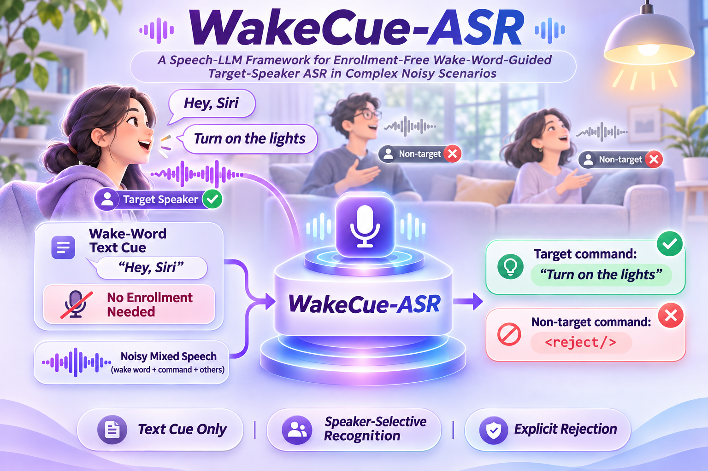
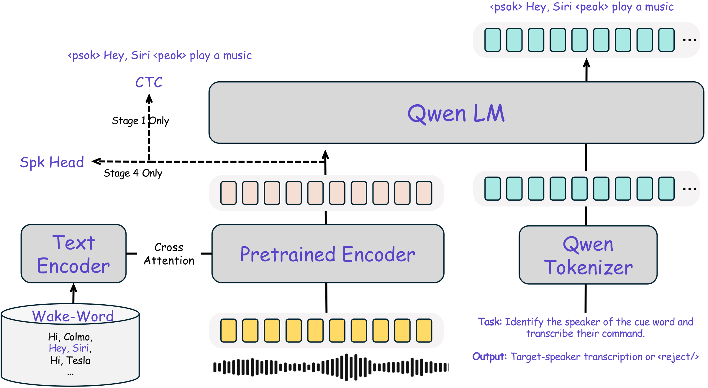
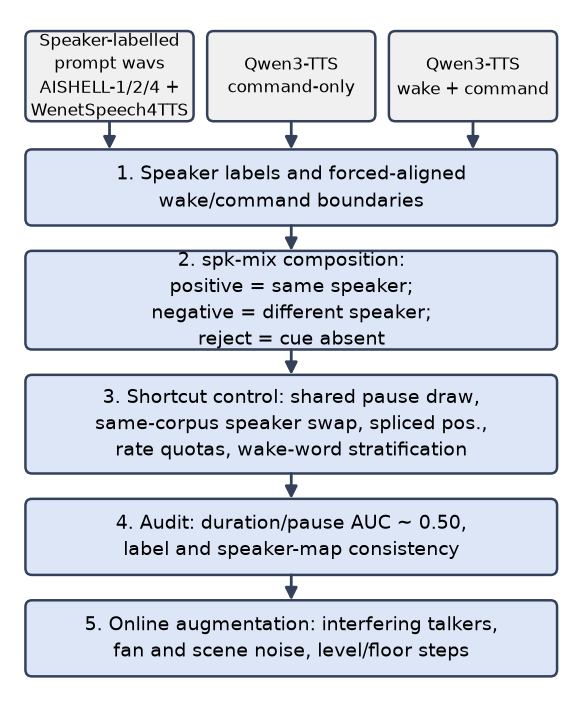
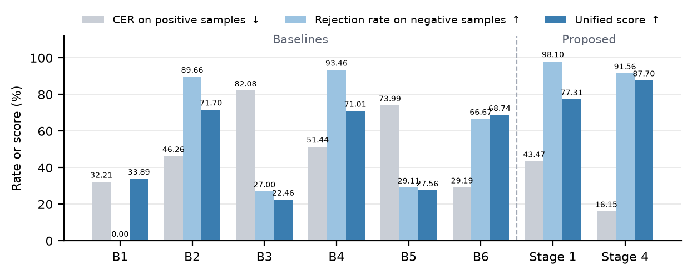

# WakeCue-ASR



**WakeCue-ASR** is a speech-LLM framework for **enrollment-free, wake-word
guided target-speaker ASR** in complex noisy scenarios. Several people talk at
once, and the target speaker's command starts with a wake word. Given that wake
word as a **text cue** — no enrollment recording and no speaker embedding — the
model transcribes only the speaker who says it and ignores everyone else. If the
cue is absent, or is said by another speaker, it returns `<reject/>` instead of
transcribing the wrong person.

- Paper: coming soon
- Model: [huggingface.co/YuCeong-May/WakeCue-ASR](https://huggingface.co/YuCeong-May/WakeCue-ASR)
- Demo: [WakeCue-ASR Space](https://huggingface.co/spaces/YuCeong-May/WakeCue-ASR)
- Inference code: the [`tcg_tsasr` package](https://huggingface.co/spaces/YuCeong-May/WakeCue-ASR/tree/main/tcg_tsasr)
  in the WakeCue-ASR Space repository.
- Language: Mandarin Chinese, 16 kHz audio. Audio within 20 seconds is recommended.
- Weights: `model.pt` (1.6 GB) in the model repository, SHA-256
  `870aef70a8a8c2b292b3eb959ea4a0907edc751848729070aea04465b449fcf5`.

## Architecture



| Component | Details | Parameters |
|---|---|---:|
| Front end | 80-dim kaldi fbank, 25 ms window, 10 ms shift, conv subsampling (4x) to 25 Hz | - |
| CueEncoder | 8406-unit cue vocabulary (Chinese characters and subwords) + 4 Transformer layers, dim 256 | 7.5 M |
| AcousticEncoder | 9 Conformer layers (dim 256, 4 heads, FFN 2048, conv kernel 15); every layer cross-attends to the cue | 27.5 M |
| Projector | Gated 4-frame Conv1d, stride 2 (12.5 audio tokens/s), bottleneck, projected to 896 | 3.6 M |
| LLM | Qwen2.5-0.5B (24 layers, hidden 896) with LoRA r = 64, alpha = 128 on q/k/v/o, gate/up/down and lm_head | 494 M base + 45 M LoRA |
| CTC head | On the Conformer stack, stage 1 only | 2.2 M |
| Speaker head | Speaker classification, stage 4 only | 1.8 M |

The CTC head and the speaker head are training-time auxiliaries and are not used
at inference. The LLM is prompted with the cue and decodes greedily:

- `<psok>cue<peok>command` when the target speaker is found. The cue is
  bracketed where it occurs; the demo strips the brackets.
- `<psok>cue<peok><reject/>` when the cue is heard but not from the target speaker.
- `<reject/>` when the cue is not in the audio.

`model.pt` (1.6 GB) holds every weight the model needs, including the Qwen2.5-0.5B
base weights, so nothing else is downloaded. The checkpoint also contains the
training-only speaker-classification head (1.8 M), which inference ignores.

The model has 579 M parameters, 85 M of them trainable (the LoRA adapters and
the projector). `model.pt` stores 715 M weight values, 136 M more, because the
Qwen input embedding and output head are tied and, since LoRA is applied to
`lm_head`, the shared matrix appears once as `embed_tokens.weight` and once as
`lm_head.base_layer.weight` (element-wise identical). That duplicate is what
makes the file 1.6 GB; it is not an extra trained module.

```python
from tcg_tsasr import TextCueGuidedTSASR  # from the Space repository

asr = TextCueGuidedTSASR.from_pretrained("YuCeong-May/WakeCue-ASR")
out = asr.transcribe("examples/0.wav", "附近居民")
print(out["text"], out["rejected"])
```

## Training data



The model has to decide whether the command is spoken by the person who said
the wake word, so the training samples pair wake words and commands from the
same speaker and from different speakers. They are simulated as follows:

- **Source speech.** Speaker-labelled utterances from AISHELL-1, AISHELL-2,
  AISHELL-4, WenetSpeech and WenetSpeech4TTS provide the voice prompts for
  Qwen3-TTS. Every synthesized utterance keeps the speaker ID of its prompt.
- **Synthesis.** Qwen3-TTS generates two kinds of speech. Command-only
  utterances are later joined to an utterance of the same or of another
  speaker. Wake-plus-command utterances are synthesized as one sequence, so
  the wake word and the command share one acoustic context.
- **spk-mix.** A manifest stores the wake segment, the command segment, their
  boundary and the speaker IDs. Same-speaker pairs become positives
  (`<psok>cue<peok>command`), different-speaker pairs become negatives
  (`<psok>cue<peok><reject/>`), and samples without the cue become
  cue-absent rejections (`<reject/>`).
- **Shortcut control and audit.** The samples are composed so that duration,
  pauses, splicing or the source corpus do not reveal the label. An audit
  confirms that duration and pause features predict the label only at chance
  (AUC ≈ 0.50) and that labels and speaker maps are consistent.
- **Online augmentation.** Interfering talkers and background noise (fans,
  scene noise) are added on the fly during training. The speaker relation is
  fixed by the manifest, while the acoustic conditions change from epoch to
  epoch.

## Results on midea-test

midea-test is a smart-home wake-plus-command test set from the
[Midea AI challenge](https://ai.midea.com/#/match-detail): 1838 utterances
recorded with overlapping speech and household interference (air conditioners
and other appliances, music, singing, background speech), at SNRs from -5 to
5 dB, with 0-100 % speaker overlap and at most two speakers talking at once.

All values are in %:

- **pos-CER**: command CER on positive samples; a rejected positive counts as
  deleting every reference character.
- **FR**: false-rejection rate, the fraction of positives with empty output.
- **RR**: rejection rate, the fraction of negatives with empty output.
- **U** = (100 - pos-CER + RR) / 2, the unified score, which weighs recognizing
  positives and rejecting negatives equally. It is computed from unrounded rates.

The baselines are enrollment-free systems built from public pretrained models;
none of them is trained on this task, and their Qwen3-ASR components are
Qwen3-ASR-1.7B. The B2 similarity threshold τ was selected on this same test
set, which favours B2. S1-S4 are the four training stages of WakeCue-ASR; the
released `model.pt` is the Stage 4 model.

| ID | System | pos-CER ↓ | FR ↓ | RR ↑ | U ↑ | Notes |
|---|---|---:|---:|---:|---:|---|
| B1 | Qwen3-ASR-1.7B | 32.21 | 0.00 | 0.00 | 33.89 | Direct ASR |
| B2 | CAM++ + Qwen3-ASR | 46.26 | 27.05 | 89.66 | 71.70 | Speaker gating & ASR; τ = 0.28 |
| B3 | Qwen2.5-Omni-7B | 82.08 | 28.08 | 27.00 | 22.46 | Audio-LLM prompting |
| B4 | MOSS-Transcribe-Diarize | 51.44 | 35.92 | 93.46 | 71.01 | Multi-talker ASR & text matching |
| B5 | WeSep + Qwen3-ASR | 73.99 | 1.25 | 29.11 | 27.56 | Speech separation & ASR |
| B6 | CocktailASR-1 | 29.19 | 9.60 | 66.67 | 68.74 | Wake segment as reference |
| S1 | WakeCue-ASR, Stage 1 (CTC) | 43.47 | 45.82 | 98.10 | 77.31 | Text-cue encoder |
| S2 | WakeCue-ASR, Stage 2 | 29.15 | 20.67 | 93.25 | 82.05 | LLM alignment |
| S3 | WakeCue-ASR, Stage 3 | 20.47 | 13.86 | 90.72 | 85.12 | Joint training |
| S4 | WakeCue-ASR, Stage 4 | **16.15** | **9.46** | 91.56 | **87.70** | Speaker supervision |

pos-CER, RR and U of the baselines and of Stages 1 and 4, with B2 at its best
threshold:



## Results on TS-Aishell

TS-Aishell mixes two speakers from AISHELL-1 and the AISHELL-2 test sets (iOS,
Android, Mic, and a cross-device mix). Each of the five test sets has 6000
mixtures. The text cue is the first 2-5 characters of the target speaker's
sentence, standing in for a wake word. Decoding is greedy.

CER / SER / reject rate in %. A rejected utterance is scored on whatever text the
model produced.

| Test set | 2 chars | 3 chars | 4 chars | 5 chars |
|---|---|---|---|---|
| aishell1-ts | 4.21 / 20.32 / 0.92 | 2.69 / 17.08 / 0.35 | 2.09 / 15.23 / 0.32 | **1.83** / 13.90 / 0.57 |
| aishell-ios-ts | 11.56 / 44.55 / 3.67 | 8.77 / 38.73 / 3.12 | 7.22 / 34.32 / 4.47 | **6.34** / 29.25 / 7.58 |
| aishell-android-ts | 15.00 / 49.98 / 4.70 | 11.26 / 43.78 / 3.57 | 9.60 / 38.75 / 4.18 | **8.76** / 34.58 / 6.50 |
| aishell-mic-ts | 12.21 / 46.02 / 3.85 | 9.33 / 39.63 / 3.23 | 7.62 / 34.93 / 4.10 | **6.42** / 30.23 / 6.68 |
| aishell-mix-ts | 8.35 / 37.55 / 2.78 | 5.91 / 32.37 / 2.63 | 4.76 / 28.55 / 3.32 | **3.94** / 23.70 / 5.40 |

Longer cues help: going from 2 to 5 characters cuts CER by 42-57 % relative.
The model is deliberately conservative: it rejects 5-8 % of AISHELL-2
utterances when the cue is unclear rather than transcribing another speaker.

## Limitations

- Mandarin only; the cue must be words the target speaker actually says.
- Evaluated with at most two simultaneous speakers. More speakers and long
  audio (over 20 s) are not evaluated.
- Cues of 2-5 characters are recommended; longer cues are accepted but untested.

## License

- Model weights and code: Apache-2.0, see `LICENSE`.
- The embedded Qwen2.5-0.5B weights are also under Apache-2.0.
